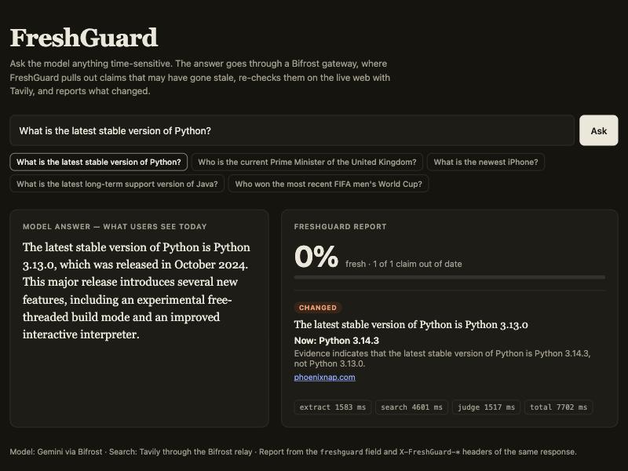
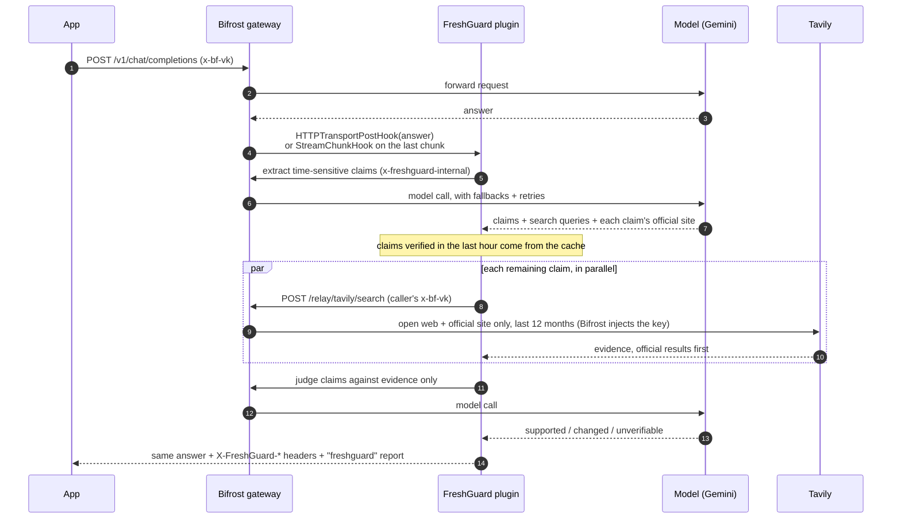

<div align="center">

# FreshGuard

**Catch stale facts in LLM answers — at the AI gateway, with sources.**

A [Bifrost](https://github.com/maximhq/bifrost) plugin that finds time-sensitive claims in model answers,<br>
re-checks them on the live web with [Tavily](https://tavily.com), and tells you what changed.

[](https://github.com/sidharth-cs/freshguard/actions/workflows/ci.yml)
[](plugin/go.mod)
[](https://github.com/maximhq/bifrost)
[](https://tavily.com)
[](#-results)
[](LICENSE)

**[▶ Try it live](https://freshguard-demo.onrender.com)** · [Quickstart](#-quickstart) · [How it works](#-how-it-works) · [Results](#-results) · [Configuration](#%EF%B8%8F-configuration) · [Contributing](CONTRIBUTING.md)



**[Try it live](https://freshguard-demo.onrender.com)** (free hosting: the first visit after a quiet spell takes about a minute to wake up) · **[Watch the 48-second demo](docs/demo.mp4)**

</div>

---

## ✨ Why

Models answer from training data that is months or years old — and state outdated facts with full confidence. Asked in November 2026 who the UK Prime Minister is, Gemini said **Keir Starmer**. FreshGuard checked: **Andy Burnham, since 20 July 2026** (source: House of Lords Library).

Teams running many LLM apps behind one gateway have no single place to catch this. Every app would need its own retrieval or fact-checking. **The gateway already sees every answer**, so FreshGuard checks them there — no change to the calling app.

```http
HTTP/1.1 200 OK
X-FreshGuard-Score: 0.00
X-FreshGuard-Stale: 1
```
```jsonc
"freshguard": {
  "status": "checked", "score": 0, "stale": 1,
  "timings_ms": { "extract": 1132, "search": 1018, "judge": 1460 },
  "claims": [{
    "claim": "The current Prime Minister of the United Kingdom is Keir Starmer.",
    "verdict": "changed",
    "current_value": "Andy Burnham",
    "explanation": "Keir Starmer resigned and Andy Burnham became UK prime minister on July 20, 2026.",
    "sources": ["https://lordslibrary.parliament.uk/…", "https://www.wshu.org/…"]  // shortened
  }]
}
```

## 🚀 Quickstart

**Needs:** a [Gemini API key](https://aistudio.google.com/apikey) (free tier works) and a [Tavily API key](https://app.tavily.com).

### Option A: Docker (any OS, one command)

```bash
git clone https://github.com/sidharth-cs/freshguard && cd freshguard
cp .env.example .env          # fill in GEMINI_API_KEY and TAVILY_API_KEY
docker compose up --build     # builds Bifrost v2.4.0 + the plugin, then serves the demo
```

Open **http://localhost:8000**. The image compiles Bifrost and FreshGuard with the same Go toolchain and flags (a requirement for Go plugins), runs the plugin's tests during the build, and keeps the gateway private inside the container (only the demo page is published; Bifrost's admin UI is not bundled, use Option C for it).

### Option B: hosted, one click

Already running at **https://freshguard-demo.onrender.com**. To host your own:

[](https://render.com/deploy?repo=https://github.com/sidharth-cs/freshguard)

Uses [`render.yaml`](render.yaml) and the same Dockerfile; Render asks for the two API keys. A public demo is capped twice: the demo page allows `DEMO_MAX_PER_MIN` questions per minute across all visitors, and **Bifrost governance** rate-limits the demo virtual key (`DEMO_REQ_PER_DAY` requests and `DEMO_TOKENS_PER_DAY` tokens a day), so nobody can drain your keys.

### Option C: from source (macOS or Linux)

**Also needs:** Go (the build fetches the exact toolchain), `git`, `make`, Node.js (for Bifrost's UI).

```bash
./dev.sh up                   # first run clones + builds Bifrost v2.4.0 (~2 min); gateway on :8080, demo on :8000
```

`dev.sh` sets up a Tavily relay and a demo virtual key (`run/demo_vk`) with FreshGuard switched on. Use `./dev.sh run` for the gateway alone. Call it directly:

```bash
curl -s localhost:8080/v1/chat/completions \
  -H "Content-Type: application/json" \
  -H "x-bf-vk: $(cat run/demo_vk)" \
  -d '{"model":"gemini/gemini-3.5-flash-lite",
       "messages":[{"role":"user","content":"What is the latest stable Python version?"}]}'
```

Streaming works too: add `"stream": true` and the **last chunk** carries the report at `extra_fields.raw_response.freshguard`. Earlier chunks are untouched, so tokens still arrive as they are generated.

### Demo page

Ask anything time-sensitive (or click a preset: versions, leaders, prices, wages, laws) and see the model's answer next to the FreshGuard report. The tiny stdlib-only server adds the virtual key server-side, so it never reaches the browser. From source, the Bifrost dashboard is at http://localhost:8080.

<details>
<summary><b>Why does it build Bifrost from source?</b></summary>

Go plugins (`.so`) load only into a **dynamically linked** Bifrost, which Bifrost documents as `make build DYNAMIC=1`. The official static binaries and Docker images cannot load `.so` plugins, and Bifrost's WASM plugins are deprecated and cannot make network calls. The plugin must also match the gateway's Go toolchain, build flags and dependency versions exactly — the [`Dockerfile`](Dockerfile) and `dev.sh` handle all of it. The full story: [`docs/SPIKE.md`](docs/SPIKE.md).
</details>

## 🧠 How it works



**Bifrost does the plumbing, Tavily does the knowing.**

| | Role |
|---|---|
| **Bifrost** | Hosts the plugin in the request path; serves the extract and judge model calls with fallbacks and retries; holds the Tavily credential in a **relay** instead of the plugin; every FreshGuard call carries the caller's **virtual key**, so checks are governed and billed under the key that triggered them. |
| **Tavily** | Live web search with a recency filter (`time_range`), a second search restricted to the claim's official site (`include_domains`), and readable snippets — the only evidence a verdict may rest on. |

### Design choices

- **Fails open** — a failed search, bad model reply or timeout never breaks the user's answer; the report says `"status": "error"` or marks claims `unverifiable`.
- **Evidence only** — the judge sees only Tavily results, and any cited URL not in them is dropped. No invented sources.
- **No recursion** — FreshGuard's own model calls carry `x-freshguard-internal` and are never checked.
- **No credential leaks** — a virtual key is forwarded only to this gateway, never to a third-party URL (there's a test for it).
- **Operator-controlled** — on for chosen virtual keys, for all traffic, or per request via `x-freshguard: on`.
- **Official sources win** — the extractor names the site that publishes the authoritative answer (`python.org`, `gov.uk`, `usps.com`); its results are searched separately, marked `[official]`, and preferred when sources disagree.
- **Cached** — supported and changed verdicts are reused for `cache_ttl_minutes` (default 60), so a repeated claim skips search and judging. `unverifiable` is never cached. The report's `cached` field counts hits.
- **Streaming-aware** — streamed answers are collected chunk by chunk and checked once, on the final chunk.

## 📊 Results

[`eval/cases.json`](eval/cases.json): 37 single-claim answers — 18 **stale** (outdated by Nov 2026: versions, leaders, **prices**, **wages**, **laws**), 12 **current** (time-sensitive but true, or dated past events) and 7 **timeless** (must never be flagged). Run live through the gateway, Gemini 3.5 Flash-Lite + Tavily via the Bifrost relay:

| Metric | Result | Target |
|---|---|---|
| Stale claims caught | **18 / 18 (100%)** | ≥ 70% |
| Current / timeless wrongly flagged | **0 / 19 (0%)** | ≤ 15% |
| Checks that errored | 1 / 37 (a model timeout; passed on re-run) | 0 |
| One uncontended check | **~2.5 s** (extract 1.05 + search 0.30 + judge 1.10, Nov 6) | < 3 s |
| Repeat claim (cache hit) | search + judge **skipped** (0 ms) | — |

The pricing and regulation cases come back with the current value from the source: Forever stamp **82¢**, Netflix Standard **$19.99**, Spotify **$12.99**, UK National Living Wage **£12.71**, EU AI Act **passed**. `basic` and `advanced` Tavily depth scored the same on the first 30 cases, so `basic` (half the credits) is the default. Full per-case tables: [`eval/`](eval).

<details>
<summary><b>What the eval caught and fixed</b></summary>

The first run scored 77% caught, 1 wrong, 3 errors ([`results-advanced-run1.md`](eval/results-advanced-run1.md)):

| What went wrong | Fix |
|---|---|
| Gemini free-tier `429`s and a timeout | Bifrost provider retries with backoff |
| A raw line break broke the model's JSON | Model calls request JSON mode |
| "Starmer *became* PM in 2024" rewritten as "*is* PM" and flagged | Claims keep their tense; dated past events are skipped |
| 2023 blog posts used as evidence | Year in the query; Tavily limited to the last year |

**Caveats:** 37 hand-labelled cases is small. Latency depends on the model provider: under eval load (3 concurrent checks on free-tier Gemini) p50 was ~6 s on Nov 6, and on Nov 8, when a bare one-word Gemini call took ~10 s, p50 was 16 s and one check hit the 60 s eval timeout. Search stayed under 3 s throughout. Every verdict ships with sources so disagreements can be audited.
</details>

Re-run it yourself:

```bash
./dev.sh run                                   # terminal 1
cd plugin && FG_DEPTH=basic GOWORK=off go test -mod=mod -tags eval -run TestEval -v -timeout 20m .
```

## ⚙️ Configuration

Plugin block in Bifrost's `config.json` (the full demo config, with relay and virtual key, is generated by [`dev.sh`](dev.sh)):

```json
{
  "enabled": true,
  "name": "freshguard",
  "path": "/abs/path/to/freshguard.so",
  "config": {
    "gateway_url": "http://localhost:8080",
    "model": "gemini/gemini-3.5-flash-lite",
    "fallbacks": ["gemini/gemini-3.1-flash-lite"],
    "tavily_url": "http://localhost:8080/relay/tavily",
    "virtual_keys": ["env.FRESHGUARD_DEMO_VK"],
    "trigger": "header"
  }
}
```

| Field | Default | Meaning |
|---|---|---|
| `gateway_url` | `http://localhost:8080` | This Bifrost's own URL; FreshGuard's model calls go back through it. |
| `model` / `fallbacks` | `gemini/gemini-3.5-flash-lite` / none | Model for extraction and judging, with Bifrost fallbacks. |
| `tavily_url` | `https://api.tavily.com` | Tavily base URL, or a Bifrost relay (`<gateway_url>/relay/<name>`). |
| `tavily_api_key` | empty | Only for direct Tavily calls; literal or `env.NAME`. Leave empty with a relay. |
| `search_depth` | `basic` | `basic` (1 credit) or `advanced` (2 credits). Equal accuracy on our eval. |
| `time_range` | `year` | Tavily recency filter: `day`, `week`, `month`, `year`, or `""`. |
| `max_claims` | `5` | Most claims checked per answer. |
| `trigger` | `header` | `always`: check every chat completion. `header`: check when the request sends `x-freshguard: on` or uses a key in `virtual_keys`. |
| `virtual_keys` | none | Virtual keys (literal or `env.NAME`) whose requests are always checked. |
| `timeout_seconds` | `30` | Budget for the whole check. |
| `cache_ttl_minutes` | `60` | Reuse supported/changed verdicts this long. `0` disables the cache. |

**Response additions:** `X-FreshGuard-Score` (0 = all stale … 1 = all current; `unverifiable` counts 0.5; `-1` = check failed), `X-FreshGuard-Stale` (number of `changed` claims) and a `freshguard` object in the JSON body.

**Streaming:** the final chunk carries the same report at `extra_fields.raw_response.freshguard` (headers are already sent by then, so there are no `X-FreshGuard-*` headers). Bifrost chunks have no free-form plugin field, so `raw_response` is used; a provider's own raw response, if enabled, moves to `raw_response.provider`.

**Scope:** `/v1/chat/completions` (streaming and non-streaming) over Bifrost's HTTP transport. With governance on, Bifrost requires a virtual key on every request.

## 🗂️ Project layout

```
plugin/            Go plugin — hooks, Bifrost + Tavily clients (main.go), pipeline (freshguard.go), tests
eval/              labelled cases + result tables
demo/              demo page + stdlib proxy
docs/              design notes (PRD, build spike, upstream proposal), screenshots, demo video
dev.sh             build Bifrost (dynamic) + plugin, generate config, run (run | up)
Dockerfile         one image: Bifrost + plugin + demo page (compose.yaml, render.yaml)
```

## 🧪 Tests

```bash
cd plugin && GOWORK=off go test -mod=mod ./...
```

Covers the pipeline with a fake model and search (stale detection, no claims, malformed model output, unknown verdicts, claim cap), the claim cache (hits, expiry, never caching `unverifiable`), official-site search (ordering, de-duplication), the streaming hook (report on the last chunk only, untouched when not opted in), eligibility rules, response rewriting, config validation, and that a virtual key is never sent to a non-gateway URL. CI runs them with `-race`, and the Docker build runs them again.

## 🛣️ Roadmap

- [x] Cache recently verified claims
- [x] Prefer official sources and newer pages
- [x] Check streaming responses
- [x] One-command Docker setup and a hosted demo
- [x] Pricing and regulation cases in the eval
- [x] Propose upstream as a Bifrost plugin ([maximhq/bifrost#9748](https://github.com/maximhq/bifrost/issues/9748))
- [ ] Shared cache across gateway replicas (Bifrost's cache store)
- [ ] A plugin-metadata field on Bifrost stream chunks, instead of `raw_response`
- [ ] Larger, shared eval set

## 🤝 Contributing

Issues and PRs welcome — see [CONTRIBUTING.md](CONTRIBUTING.md). Found a security issue? See [SECURITY.md](SECURITY.md).

## 🏆 Hackathon

Built for the **Geek Room Global AI Hackathon** (Nov 2026). Primary problem statement **#4** — build the missing open-source Bifrost gateway feature. Also addresses **#5** — stale-answer detector (Tavily).

**AI usage:** an LLM (Gemini, via Bifrost) runs inside the product for claim extraction and judging. The code was written with Claude Code (Anthropic) as a pair programmer.

## 📄 License

[Apache-2.0](LICENSE), matching Bifrost.
